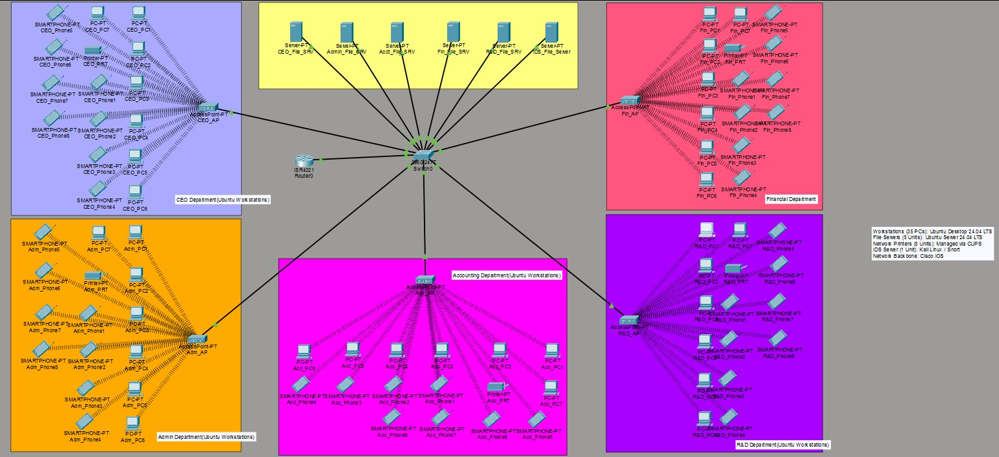

# Enterprise Wireless Network Redesign & VLAN Segmentation (Cisco Packet Tracer)

<p align="center">
  <a href="#english-version">English Version</a> •
  <a href="#中文版本">中文版本</a>
</p>

<p align="center">
  
  
  
  
</p>

<a id="english-version"></a>
## English Version

### 1. Project Overview
This project presents a redesigned enterprise wireless network architecture for **TLSW Corporation** (~40 staff, 35 workstations), migrating from an outdated flat-wired Windows infrastructure to a segmented, Linux-based (`Ubuntu 24.04 LTS`) wireless topology simulated in **Cisco Packet Tracer**. The design enforces strict departmental isolation via **5 VLANs**, **`/27` CIDR subnetting**, **Router-on-a-Stick** inter-VLAN routing, **Cisco IOS Extended ACLs**, and **NIST SP 800-114 Rev. 1** BYOD security governance.

> **Scope Note:** This architecture was originally developed as the network design and Packet Tracer topology module of a university coursework project, and was independently extended with Cisco IOS Extended ACL policy enforcement and end-to-end connectivity/isolation verification.

### 2. Network Topology & Infrastructure
The network follows a centralized **star topology** radiating from a physically secured Server Room housing the core `Cisco 2960-24TT` switch, main router, centralized file servers, and IDS server, connecting outward to 5 dedicated departmental Wireless Access Points.

<p align="center">
  
</p>

### 3. Technical Architecture
| Design Pillar | Implementation Details |
| :--- | :--- |
| **Topology & Switching** | Star topology anchored by a central `Cisco 2960-24TT` core switch and single main router (Router-on-a-Stick) |
| **Departmental VLANs (5)** | Logical isolation across **CEO**, **Financial**, **Admin**, **Accounting**, and **R&D** zones to limit broadcast domains |
| **IP Addressing (`/27` CIDR)** | `/27` subnetting (30 usable hosts per subnet) balancing address efficiency with room for departmental growth |
| **Access Control** | Cisco IOS Extended ACL rules restricting cross-department access to sensitive zones |
| **Endpoint Modernization** | Migration to **Ubuntu 24.04 LTS** across workstations/servers to eliminate licensing overhead and reduce attack surface |

### 4. How to Run & Replicate
1. Install **Cisco Packet Tracer v8.0+**.
2. Download and open [`enterprise-wlan-topology.pkt`](enterprise-wlan-topology.pkt).
3. Inspect VLAN assignments (`show vlan brief`) on the core switch and sub-interfaces/ACLs (`show running-config`, `show access-lists`) on the main router.
4. Run ICMP `ping` tests across departmental workstations to verify permitted vs. blocked inter-VLAN traffic.
5. Refer to [`network-architecture-report.pdf`](network-architecture-report.pdf) for full IP tables, design rationale, and security analysis.

### 5. Verification & Security Testing
#### 5.1 Authorized Connectivity Test (CEO Zone)
Verified end-to-end routing and authorized network reachability from the CEO VLAN to target enterprise resources:

<p align="center">
  
</p>

#### 5.2 ACL Isolation Test (R&D Zone)
Verified that Cisco IOS Extended ACL policies successfully block unauthorized cross-VLAN traffic from the R&D zone to restricted segments:

<p align="center">
  
</p>

### 6. Security Governance
- **BYOD Policy (NIST SP 800-114 Rev. 1)**: Enforces network segmentation, strong wireless encryption, endpoint compliance checks, and least-privilege access for staff mobile devices.
- **Centralized Server Room**: Physical consolidation of file servers and IDS monitoring behind core switch/router ACL boundaries.

### 7. Repository Structure
```text
enterprise-wlan-vlan-architecture/
├── README.md
├── enterprise-wlan-topology.pkt          # Cisco Packet Tracer simulation file
├── network-architecture-report.pdf       # Detailed architecture & security report
└── images/
    ├── network-topology.jpeg             # Physical & logical 5-VLAN star topology
    ├── ceo-connectivity-test.jpeg        # Authorized CEO VLAN connectivity verification
    └── rd-acl-isolation-test.jpeg        # R&D VLAN Extended ACL isolation verification
```

---

<a id="中文版本"></a>
## 中文版本

### 1. 项目概述
本项目基于 **Cisco Packet Tracer** 为 **TLSW Corporation**（约 40 名员工、35 台工作站）重构了一套企业级分段无线网络架构，将老旧的扁平有线 Windows 网络迁移至基于 Linux（`Ubuntu 24.04 LTS`）的分段无线拓扑。设计通过 **5 个部门级 VLAN**、**`/27` CIDR 子网划分**、**Router-on-a-Stick（单臂路由）**、**Cisco IOS 扩展 ACL** 以及符合 **NIST SP 800-114 Rev. 1** 的 BYOD 安全治理，实现严格的部门级逻辑隔离。

> **范围说明：** 本架构最初作为大学课程团队作业中的网络设计与 Packet Tracer 拓扑模块开发，后续独立扩展实现了 Cisco IOS 扩展 ACL 访问控制策略部署以及端到端连通性与隔离性验证。

### 2. 网络拓扑与基础设施
网络采用以物理受控的中心机房为核心的**星型拓扑**，机房内集中部署 `Cisco 2960-24TT` 核心交换机、主路由器、部门文件服务器及 IDS 服务器，向外辐射连接至 5 个独立的部门级无线接入点（AP）。

<p align="center">
  
</p>

### 3. 技术架构设计
| 设计维度 | 实现细节 |
| :--- | :--- |
| **拓扑与交换路由** | 以中心 `Cisco 2960-24TT` 核心交换机与单台主路由器构建星型拓扑（Router-on-a-Stick 单臂路由） |
| **部门级 VLAN（5 个）** | 划分 **CEO、Financial、Admin、Accounting、R&D** 5 个逻辑隔离区，限制广播域并隔离敏感数据 |
| **IP 地址规划（`/27` CIDR）** | 采用 `/27` 子网划分（每个子网 30 个可用主机地址），兼顾地址利用率与未来部门扩容需求 |
| **访问控制策略** | 在路由器接口部署 Cisco IOS 扩展 ACL，限制跨部门对敏感网段的非授权访问 |
| **终端与系统现代化** | 规划全网工作站与服务器迁移至 **Ubuntu 24.04 LTS**，消除软件授权成本并显著缩小攻击面 |

### 4. 运行与复现步骤
1. 安装 **Cisco Packet Tracer v8.0+**。
2. 下载并打开根目录下的 [`enterprise-wlan-topology.pkt`](enterprise-wlan-topology.pkt)。
3. 在核心交换机 CLI 中执行 `show vlan brief` 查看 VLAN 分配，在主路由器 CLI 中执行 `show running-config` 与 `show access-lists` 查看子接口与 ACL 策略。
4. 在不同部门终端间运行 ICMP `ping` 测试，验证允许通信与被拦截的跨 VLAN 流量。
5. 完整 IP 地址分配表、设计论证与安全分析请查阅 [`network-architecture-report.pdf`](network-architecture-report.pdf)。

### 5. 验证与安全测试
#### 5.1 授权连通性测试（CEO 区域）
验证 CEO 所在 VLAN 到目标企业资源的端到端路由及授权可达性：

<p align="center">
  
</p>

#### 5.2 ACL 隔离性测试（R&D 区域）
验证 Cisco IOS 扩展 ACL 策略成功拦截 R&D 区域向受限网段发起的非授权跨 VLAN 访问：

<p align="center">
  
</p>

### 6. 安全治理
- **BYOD 策略（NIST SP 800-114 Rev. 1）**：针对员工移动设备实施网络分段隔离、强无线加密、终端合规检查及最小权限访问控制。
- **中心化机房防护**：将文件服务器与 IDS 监控节点集中部署在核心交换机与路由器 ACL 边界之后，强化物理与逻辑双重防护。

### 7. 仓库目录结构
```text
enterprise-wlan-vlan-architecture/
├── README.md
├── enterprise-wlan-topology.pkt          # Cisco Packet Tracer 仿真源文件
├── network-architecture-report.pdf       # 完整网络架构与安全报告
└── images/
    ├── network-topology.jpeg             # 物理与逻辑 5-VLAN 星型拓扑图
    ├── ceo-connectivity-test.jpeg        # CEO 部门授权连通性测试截图
    └── rd-acl-isolation-test.jpeg        # R&D 部门扩展 ACL 隔离测试截图
```

[返回顶部 / Back to Top](#enterprise-wireless-network-redesign--vlan-segmentation-cisco-packet-tracer)
