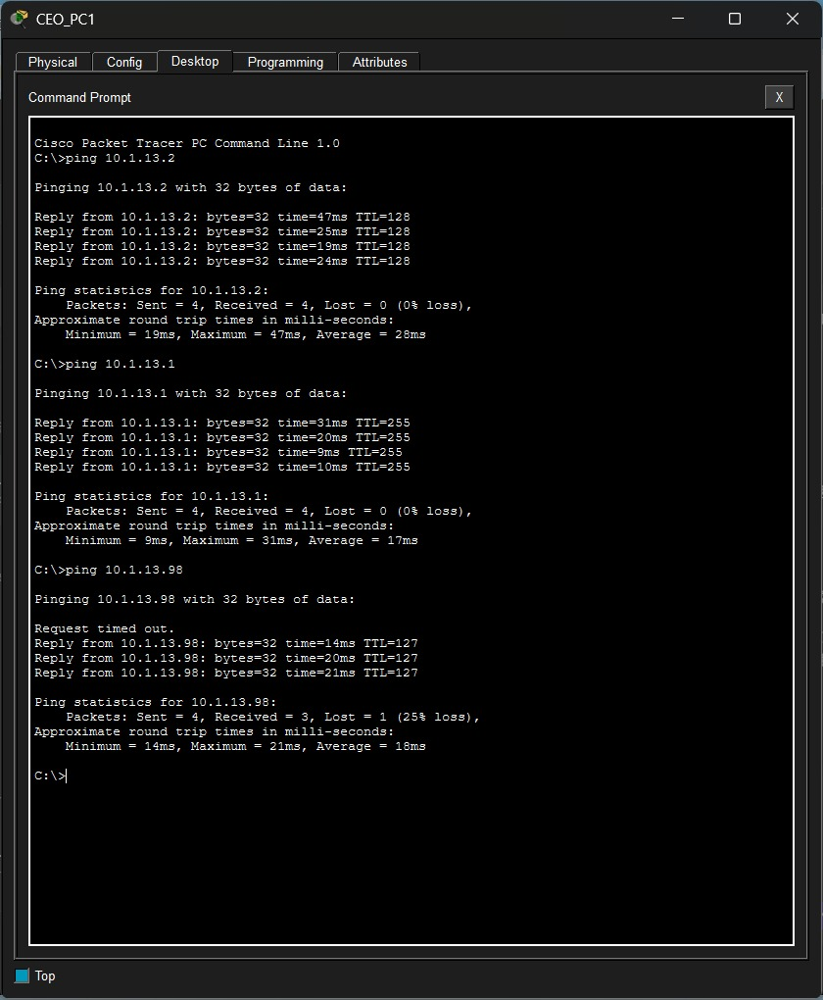
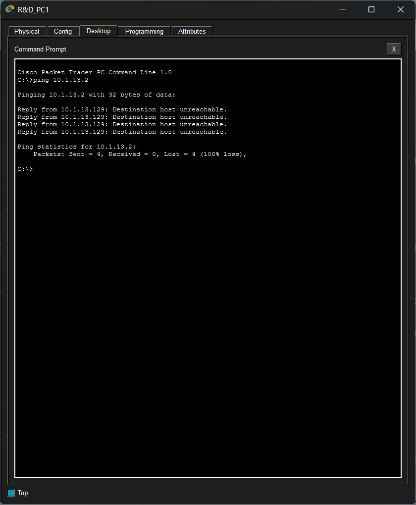

# Enterprise Wireless Network Redesign & VLAN Segmentation (Cisco Packet Tracer)

<p align="center">
  <a href="#english-version">English Version</a> •
  <a href="#中文版本">中文版本</a>
</p>

<p align="center">
  
  
  
  
</p>


<a id="english-version"></a>
## English Version

### 1. Project Overview
This project presents a redesigned enterprise wireless network architecture for **TLSW Corporation** (~40 staff, 35 workstations), migrating from an outdated flat-wired Windows infrastructure to a segmented, Linux-based (`Ubuntu 24.04 LTS`) wireless topology simulated in **Cisco Packet Tracer**. The design enforces strict departmental isolation via **5 VLANs**, **`/27` CIDR subnetting**, **Router-on-a-Stick** inter-VLAN routing, **Cisco IOS Extended ACLs**, and **NIST SP 800-114 Rev. 1** BYOD security governance.

> **Scope Note:** This architecture was originally developed as the network design and Packet Tracer topology module of a university coursework project, and was independently extended with Cisco IOS Extended ACL policy enforcement and end-to-end connectivity/isolation verification.

### 2. Network Topology & Infrastructure
The network follows a centralized **star topology** radiating from a physically secured Server Room housing the core `Cisco 2960-24TT` switch, main router, centralized file servers, and IDS server, connecting outward to 5 dedicated departmental Wireless Access Points.

<p align="center">
  
</p>

### 3. Technical Architecture
| Design Pillar | Implementation Details |
| :--- | :--- |
| **Topology & Switching** | Star topology anchored by a central `Cisco 2960-24TT` core switch and single main router (Router-on-a-Stick) |
| **Departmental VLANs (5)** | Logical isolation across **CEO**, **Financial**, **Admin**, **Accounting**, and **R&D** zones to limit broadcast domains |
| **IP Addressing (`/27` CIDR)** | `/27` subnetting (30 usable hosts per subnet) balancing address efficiency with room for departmental growth |
| **Access Control** | Cisco IOS Extended ACL rules restricting cross-department access to sensitive zones |
| **Endpoint Modernization** | Migration to **Ubuntu 24.04 LTS** across workstations/servers to eliminate licensing overhead and reduce attack surface |

### 4. How to Run & Replicate
1. Install **Cisco Packet Tracer v8.0+**.
2. Download and open [`enterprise-wlan-topology.pkt`](enterprise-wlan-topology.pkt).
3. Inspect VLAN assignments (`show vlan brief`) on the core switch and sub-interfaces/ACLs (`show running-config`, `show access-lists`) on the main router.
4. Run ICMP `ping` tests across departmental workstations to verify permitted vs. blocked inter-VLAN traffic.
5. Refer to [`network-architecture-report.pdf`](network-architecture-report.pdf) for full IP tables, design rationale, and security analysis.

### 5. Verification & Security Testing
#### 5.1 Authorized Connectivity Test (CEO Zone)
Verified end-to-end routing and authorized network reachability from the CEO VLAN to target enterprise resources:

<p align="center">
  
</p>

#### 5.2 ACL Isolation Test (R&D Zone)
Verified that Cisco IOS Extended ACL policies successfully block unauthorized cross-VLAN traffic from the R&D zone to restricted segments:

<p align="center">
  
</p>

### 6. Security Governance
- **BYOD Policy (NIST SP 800-114 Rev. 1)**: Enforces network segmentation, strong wireless encryption, endpoint compliance checks, and least-privilege access for staff mobile devices.
- **Centralized Server Room**: Physical consolidation of file servers and IDS monitoring behind core switch/router ACL boundaries.

### 7. Repository Structure
```text
enterprise-wlan-vlan-architecture/
├── README.md
├── enterprise-wlan-topology.pkt          # Cisco Packet Tracer simulation file
├── network-architecture-report.pdf       # Detailed architecture & security report
└── images/
    ├── network-topology.jpeg             # Physical & logical 5-VLAN star topology
    ├── ceo-connectivity-test.jpeg        # Authorized CEO VLAN connectivity verification
    └── rd-acl-isolation-test.jpeg        # R&D VLAN Extended ACL isolation verification
```

---

<a id="中文版本"></a>
## 中文版本

### 1. 项目概述
本项目基于 **Cisco Packet Tracer** 为 **TLSW Corporation**（约 40 名员工、35 台工作站）重构了一套企业级分段无线网络架构，将老旧的扁平有线 Windows 网络迁移至基于 **Ubuntu 24.04 LTS** 的安全无线环境。方案涵盖 **5 个部门级 VLAN 隔离**、**`/27` CIDR 子网划分**、**Router-on-a-Stick（单臂路由）**、**Cisco IOS 扩展 ACL 策略**以及符合 **NIST SP 800-114 Rev. 1** 的 BYOD 安全治理。

> **范围说明：** 本项目最初作为课程团队作业中的网络架构与 Packet Tracer 拓扑模块完成，后续独立扩展实现了 Cisco IOS 扩展 ACL 访问控制策略及端到端连通性与隔离性验证。

### 2. 网络拓扑与基础设施
网络采用以中心机房为核心的**星型拓扑**，集中部署 `Cisco 2960-24TT` 核心交换机、主路由器、部门文件服务器与 IDS 服务器，并向外连接至 5 个独立部门的无线接入点（AP）。

<p align="center">
  
</p>

### 3. 核心技术架构
- **单臂路由与 VLAN 分段**：通过 1 台主路由器 + `Cisco 2960-24TT` 交换机划分 **CEO、Financial、Admin、Accounting、R&D** 5 个逻辑隔离区，缩小广播域并降低硬件成本。
- **`/27` CIDR 子网规划**：每个部门子网提供 30 个可用主机地址，兼顾地址利用率与后续扩容空间。
- **Cisco IOS 扩展 ACL 与 Linux 迁移**：在路由器接口落地扩展 ACL 实现部门间访问隔离，并规划迁移至 Ubuntu 24.04 LTS 以降低授权成本与攻击面。

### 4. 连通性与 ACL 隔离验证
- **CEO 部门授权连通性测试**：验证跨网段授权通信正常。

<p align="center">
  
</p>

- **R&D 部门 ACL 隔离测试**：验证扩展 ACL 成功拦截非授权跨 VLAN 访问。

<p align="center">
  
</p>

### 5. 复现步骤与仓库结构
1. 使用 **Cisco Packet Tracer v8.0+** 打开 [`enterprise-wlan-topology.pkt`](enterprise-wlan-topology.pkt)。
2. 在核心交换机和主路由器 CLI 中执行 `show vlan brief`、`show running-config`、`show access-lists` 查看配置，并用终端 `ping` 验证隔离效果。
3. 完整 IP 地址表与安全设计说明见 [`network-architecture-report.pdf`](network-architecture-report.pdf)。

[返回顶部 / Back to Top](#enterprise-wireless-network-redesign--vlan-segmentation-cisco-packet-tracer)
